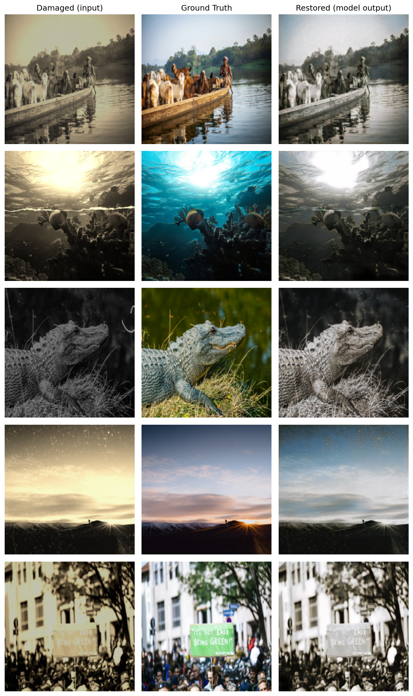
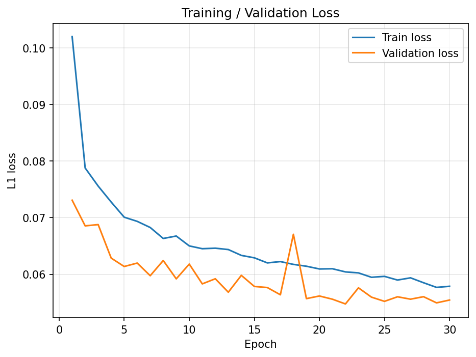

# Deep Image Restoration with U-Net

**A supervised photo-restoration experiment built with PyTorch, from paired-image preprocessing to training, checkpoint selection, and visual evaluation.**

This computer vision course group project explores restoring photographs affected by noise, scratches, and faded colors. A custom U-Net learns to map damaged RGB images to paired clean targets. On **500 held-out test images**, the recorded run achieved **23.00 dB PSNR** and **0.8626 SSIM**, exceeding both course performance targets. Color recovery remains a visible limitation.

**Stack:** Python · PyTorch · torchvision · Hugging Face Datasets · NumPy · scikit-image · pandas · Matplotlib · Jupyter / Google Colab

[Explore the notebook](CV_Final_Project_Restoration_%282%29.ipynb) · [Read the report](CV_Final_Project_Report.pdf) · [View test metrics](test_metrics.csv)

## Contents

- [Motivation and objectives](#motivation-and-objectives)
- [Key highlights](#key-highlights)
- [Results](#results)
- [Implementation](#implementation)
- [Repository structure](#repository-structure)
- [Installation and usage](#installation-and-usage)
- [Skills and learning](#skills-and-learning)
- [Technical decisions and limitations](#technical-decisions-and-limitations)
- [Future improvements](#future-improvements)
- [Project context and attribution](#project-context-and-attribution)

## Motivation and objectives

Restoring damaged photographs requires recovering visual detail while keeping the output aligned with the original scene. This project investigates how far a supervised encoder–decoder trained with a pixel-wise loss can address that problem using a few thousand image pairs.

The objectives were to build a complete restoration workflow, select a model using validation data, evaluate it on a separate test set, and compare numerical image-quality scores with visible restoration quality.

## Key highlights

- **Custom U-Net:** four encoder and decoder stages, skip connections, batch normalization, and 31,043,651 trainable parameters.
- **Paired data pipeline:** RGB conversion, 256 × 256 resizing, tensor scaling to `[0, 1]`, and a seeded training/validation split.
- **Complete training loop:** 30 epochs with Adam and L1 loss, sample-weighted epoch losses, and best-validation checkpoint saving.
- **Four-metric evaluation:** per-image MSE, MAE, PSNR, and SSIM, averaged across the test set and exported to CSV.
- **Inspectable outputs:** training curves and five reproducibly sampled input/target/prediction comparisons.

## Results

Values below are rounded from [test_metrics.csv](test_metrics.csv). Evaluation reloads the checkpoint with the lowest validation loss and compares predictions with clean targets at 256 × 256 resolution, using pixel values in `[0, 1]`.

| Metric | Test-set mean | Course target |
| --- | ---: | ---: |
| PSNR ↑ | **23.00 dB** | ≥ 20 dB |
| SSIM ↑ | **0.8626** | ≥ 0.65 |
| MSE ↓ | 0.007951 | — |
| MAE ↓ | 0.057866 | — |

Higher PSNR/SSIM and lower MSE/MAE are better. PSNR is averaged per image, rather than calculated from the aggregate MSE.

### Visual restoration quality

Columns show **damaged input → clean ground truth → model prediction**. The examples preserve recognizable scene structure, but several predictions remain desaturated and retain visible artifacts. Meeting the numerical targets does not establish complete damage removal or accurate color reconstruction.

<details>
<summary><strong>View five restoration comparisons</strong></summary>



</details>

### Training behavior

Recorded training L1 loss decreased from **0.1020** to **0.0579**. The lowest validation L1 loss was **0.0548 at epoch 22**, compared with 0.0731 at epoch 1. Validation loss fluctuates, including a spike at epoch 18; the saved logs do not establish its cause.



These results describe one recorded run. The repository contains no damaged-input baseline, architecture ablation, or repeated-run uncertainty estimates, so it does not establish improvement over alternative methods.

## Implementation

### Data and preprocessing

The notebook loads `joshuachin/openphoto-restore-dataset` through Hugging Face Datasets, using `damaged_image` as input and `pristine_image` as the target. Its recorded dataset contains 4,500 training pairs and 500 test pairs. A seeded 90/10 split of the supplied training set produces:

| Training | Validation | Test |
| ---: | ---: | ---: |
| 4,050 pairs | 450 pairs | 500 pairs |

`RestorationDataset` converts both images to RGB and applies the same deterministic resize and tensor conversion. Training batches are shuffled; validation and test batches are not. No data augmentation is implemented.

### Architecture

```text
Damaged RGB image (3 × 256 × 256)
    → Encoder: 64 → 128 → 256 → 512 channels, with max-pooling
    → Bottleneck: 1,024 channels at 16 × 16
    → Decoder: 512 → 256 → 128 → 64 channels
      (transposed convolutions + matching encoder skip connections)
    → 1 × 1 convolution + sigmoid
Restored RGB image (3 × 256 × 256)
```

Each encoder, bottleneck, and decoder block uses two 3 × 3 convolution–batch normalization–ReLU sequences. Skip connections concatenate encoder features with decoder features to retain spatial information. The sigmoid output matches the target's `[0, 1]` range.

### Training configuration

| Setting | Recorded configuration |
| --- | --- |
| Loss | L1 / mean absolute error |
| Optimizer | Adam |
| Learning rate | `1e-4` |
| Batch size | `16` |
| Epochs | `30` |
| Random seed | `42` for Python, NumPy, PyTorch, and the split |
| DataLoader workers | `0` |
| Device | CUDA; report identifies Google Colab |
| Checkpoint selection | Lowest validation L1 loss |

`run_epoch` switches between training and evaluation modes and disables gradients for validation. The best model's weights are saved during training, then reloaded for test evaluation. There is no early stopping or learning-rate schedule.

## Repository structure

```text
Deep-Image-Restoration/
├── README.md
├── CV_Final_Project_Restoration_(2).ipynb  # Workflow and saved execution outputs
├── CV_Final_Project_Report.pdf           # Method, results, and discussion
├── test_metrics.csv                      # Recorded test-set averages
├── loss_curve.png                        # Training/validation plot
└── sample_restorations.png               # Five test-image comparisons
```

The implementation lives in the [experiment notebook](CV_Final_Project_Restoration_%282%29.ipynb). Trained weights and dataset files are not included.

## Installation and usage

### Prerequisites

Use a Python environment with Jupyter support and internet access to download the dataset. The notebook metadata specifies Python 3.10. The recorded run used CUDA; the code automatically falls back to CPU when CUDA is unavailable. A compatible GPU is recommended for training this 31-million-parameter model.

From the repository directory, in your chosen Python environment:

```bash
python -m pip install torch torchvision datasets hf_xet numpy pillow pandas scikit-image matplotlib tqdm jupyterlab
python -m jupyterlab "CV_Final_Project_Restoration_(2).ipynb"
```

For GPU training, the installed PyTorch build must support your CUDA environment. Alternatively, upload the notebook to Google Colab, select a GPU runtime, and install any missing dependencies using the setup cell.

### Run in notebook order

1. Run **Setup** to initialize seeds, select the device, and create output directories.
2. Run **Data Preparation** to download image pairs, create splits, and inspect a sample batch.
3. Run **Model** and **Training Setup**, then the training loop and loss-curve cell.
4. Run **Evaluation** to reload the best checkpoint and compute test metrics.
5. Run **Visualization** to save five test comparisons (`seed=0`).

The notebook generates these paths relative to its working directory:

```text
checkpoints/unet_best.pt
outputs/loss_curve.png
outputs/test_metrics.csv
outputs/sample_restorations.png
```

The root-level figures and CSV are included results from the recorded experiment; a new run writes to `outputs/`. Evaluation requires training first because no checkpoint is distributed.

**Reproducibility limits:** package versions and the dataset revision are not pinned, and deterministic CUDA execution is not enforced. Seeds make the split and random operations repeatable under compatible conditions, but do not guarantee identical scores across environments. Reducing `BATCH_SIZE` or `IMAGE_SIZE` can lower memory requirements, but changes the experiment from the recorded configuration.

## Skills and learning

| Area | Evidence in the implementation |
| --- | --- |
| Deep learning | Custom `nn.Module` blocks, encoder–decoder design, skip connections, and backpropagation |
| Data processing | Hugging Face dataset access, paired transforms, custom `Dataset`, and batched loading |
| Experiment design | Separate validation/test splits, seeded sampling, and validation-based model selection |
| Numerical evaluation | NumPy image errors and scikit-image PSNR/SSIM with explicit data ranges |
| Technical communication | pandas CSV export, Matplotlib comparisons, and a written experiment report |

### What I learned

> **Pending author confirmation:** These reflections are inferred from the group implementation. Individual responsibilities are not recorded.

- I learned how paired preprocessing and matched input/output ranges support supervised image restoration.
- I practiced connecting a convolutional encoder–decoder to a training, validation, checkpointing, and evaluation workflow.
- I learned to read numerical metrics alongside image comparisons: meeting PSNR and SSIM targets can coexist with weak color recovery.
- I learned why selecting a checkpoint on validation data and reserving a separate test set serve different purposes.

## Technical decisions and limitations

| Challenge | Implemented response or observed limitation |
| --- | --- |
| Preserve spatial detail through compression | U-Net skip connections pass encoder features to matching decoder stages. No ablation isolates their effect here. |
| Keep paired images aligned and batchable | Apply identical resizing to input and target at 256 × 256; higher-resolution performance is untested. |
| Select weights despite validation fluctuations | Save the lowest-validation-loss checkpoint instead of automatically evaluating the final epoch. |
| Avoid notebook multiprocessing stalls | Use `NUM_WORKERS=0`, with a notebook comment advising verification before increasing it. |
| Recover colors lost in damaged inputs | L1 training leaves many outputs muted. The report proposes color ambiguity under pixel-wise loss as an explanation; this is not experimentally isolated. |

## Future improvements

These are proposed extensions, not implemented features:

- Add a damaged-input baseline and controlled loss/architecture comparisons to quantify restoration gains.
- Evaluate perceptual or color-aware objectives alongside L1, including human assessment of color fidelity and artifacts.
- Add paired spatial augmentation and test higher-resolution restoration.
- Pin dependencies and the dataset revision, publish a trained checkpoint, and add a standalone inference entry point.


